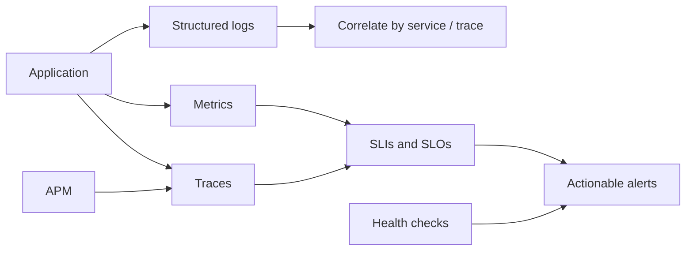

# Observability & Monitoring — Module 14

Module 14 · Observability & Monitoring: a single Java 21 learning repository with runnable examples, focused JUnit tests, trade-offs, and links to primary references. Demos are local and deterministic except for cryptographic randomness/timing; no cluster, cloud account, or external service is required.

## Learning map



## Topics

- [Logging (Structured Logging, ELK Stack)](logging/README.md)
- [Metrics (Prometheus, Grafana)](metrics/README.md)
- [Distributed Tracing (Jaeger, Zipkin, OpenTelemetry)](tracing/README.md)
- [Alerting Strategies](alerting/README.md)
- [SLOs, SLIs, SLAs](service-objectives/README.md)
- [Health Check Endpoints](health-checks/README.md)
- [Application Performance Monitoring (APM)](apm/README.md)

## Topic guide, example, and primary reference index

| Topic guide | Runnable example | Primary reference |
| --- | --- | --- |
| [Logging (Structured Logging, ELK Stack)](logging/README.md) | [LoggingDemo.java](observability/src/main/java/com/absolutebonkers/observability/logging/LoggingDemo.java) | [Reference](https://www.elastic.co/guide/en/ecs/current/ecs-reference.html) |
| [Metrics (Prometheus, Grafana)](metrics/README.md) | [MetricsDemo.java](observability/src/main/java/com/absolutebonkers/observability/metrics/MetricsDemo.java) | [Reference](https://prometheus.io/docs/concepts/metric_types/) |
| [Distributed Tracing (Jaeger, Zipkin, OpenTelemetry)](tracing/README.md) | [DistributedTracingDemo.java](observability/src/main/java/com/absolutebonkers/observability/distributedtracing/DistributedTracingDemo.java) | [Reference](https://opentelemetry.io/docs/concepts/signals/traces/) |
| [Alerting Strategies](alerting/README.md) | [AlertingStrategiesDemo.java](observability/src/main/java/com/absolutebonkers/observability/alertingstrategies/AlertingStrategiesDemo.java) | [Reference](https://sre.google/sre-book/monitoring-distributed-systems/) |
| [SLOs, SLIs, SLAs](service-objectives/README.md) | [SlosSlisSlasDemo.java](observability/src/main/java/com/absolutebonkers/observability/slosslisslas/SlosSlisSlasDemo.java) | [Reference](https://sre.google/sre-book/service-level-objectives/) |
| [Health Check Endpoints](health-checks/README.md) | [HealthChecksDemo.java](observability/src/main/java/com/absolutebonkers/observability/healthcheckendpoints/HealthChecksDemo.java) | [Reference](https://kubernetes.io/docs/concepts/configuration/liveness-readiness-startup-probes/) |
| [Application Performance Monitoring (APM)](apm/README.md) | [ApplicationPerformanceDemo.java](observability/src/main/java/com/absolutebonkers/observability/apm/ApplicationPerformanceDemo.java) | [Reference](https://opentelemetry.io/docs/concepts/signals/) |

## Build and run

Install JDK 21 and run at the repository root:

```sh
./gradlew test
./gradlew build
./gradlew :observability:run --args=logging
```

Every topic guide provides its exact run command and focused test selector. To run other examples, use the matching topic slug shown above.

## Design trade-offs at a glance

- **Diagnostic detail vs. cost/privacy:** logs and traces explain individual events but need sampling, retention, redaction, and access controls.
- **Fast aggregation vs. cardinality:** metrics summarize behavior efficiently, while unbounded labels can overwhelm storage and dashboards.
- **Fast notification vs. alert fatigue:** actionable SLO-based thresholds and grouped alerts reduce noise, while overly broad paging rules erode trust.

## Safety note

Security examples are defensive demonstrations only. They use harmless placeholder values, do not include attack payloads, do not access real credentials, and do not perform network exploitation. Cryptographic demos use JDK APIs for learning and are not a substitute for a reviewed production security design.
